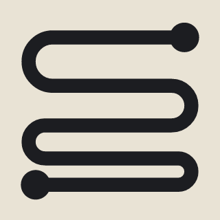
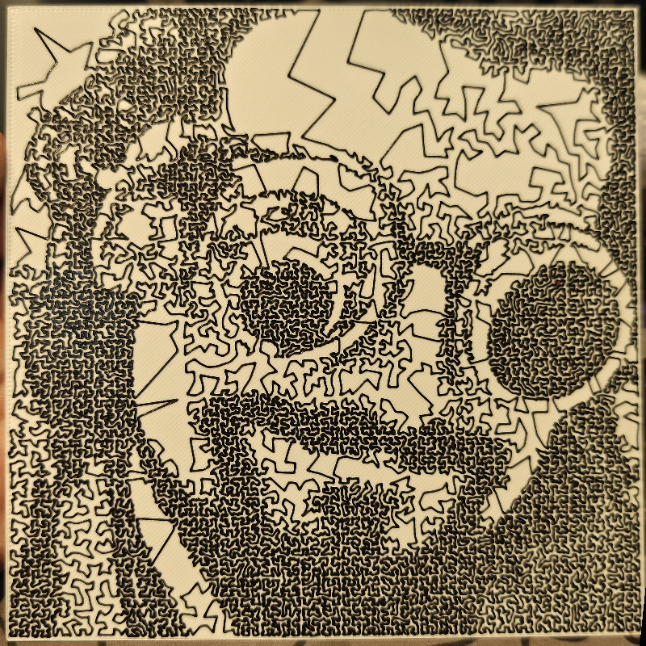

# Line Art Studio

*A real print on a Bambu Lab X1 Carbon: 150 mm square, one line.*

Also on [Orca Cloud](https://cloud.orcaslicer.com/app/plugins/shared-plugins/3f3d02f5-8199-414c-9eaf-1f075a954aa6).

Upload any photo and print it as one unbroken line that never crosses itself. The line keeps one width all the way. Dark parts of the picture appear because the line winds more tightly there.

**How to use**
1. Open the Line Art Studio tab and pick an image. Drag it to position it, scroll to zoom. The line appears after a few seconds, or up to a minute for a detailed picture.
2. Choose the shape of the art (square, circle, rectangle, oval, rounded rectangle or hexagon) and its size, the base and line filaments, the layer height and the number of base and line layers.
3. Press Save job and add base to plate. A base of that shape lands on the plate, with each filament already assigned.
4. In the process preset, under Others, set Slicing Pipeline Plugin to Line Art Studio G-code.
5. Slice. On a Bambu Lab printer the preview shows the line.

**The Slicing Pipeline Plugin setting**
The picture is made when you slice. Line Art Studio adds a slicing step that finds the top layers of its base and replaces them with the line. OrcaSlicer runs that step only when it is selected: in the process preset, open Others, find Slicing Pipeline Plugin, press Add plugin and choose Line Art Studio G-code. Save the preset to keep it. A print that is not the Line Art Studio base is left as it is, so the setting can stay on.

**What it does**
- Places points by the tone of your picture and joins them into a single line with no travel moves inside the art.
- Keeps the line from crossing itself or running into its own width.
- Prints at constant width and speed, within your filament's volumetric limit.
- The picture is cropped to the shape you pick, and the line stays inside it. A rectangle or oval takes any width and height.
- Works with any filament. No calibration print.
- Separate filaments for the base and the line, or one filament with a pause to swap it.
- A light line on a dark base, one or more line layers, contrast and gamma.

**Notes**
- Choose filaments with a strong color difference. The densest areas are about half covered by the line, so dark areas read as dense texture, not solid black.
- Faces need about 150 mm. Below 100 mm only bold shapes read well.
- OrcaSlicer asks once for permission to run a background thread, so the page stays responsive while the line is computed.
- On printers other than Bambu Lab the slicer preview shows the plain base. The line is in the exported file.
- Adding the base to the plate automatically is Windows only. Elsewhere, the page shows the file to import.
- The layer height and nozzle you enter must match your presets, or the slice stops with a message.
- Free and open source, GPL-3.0-or-later.

Printed something? Leave a comment with a photo and your settings.
