Version 1.0.0 · OrcaSlicer 2.5

# Line Art Studio: how-to guide

Line Art Studio turns a picture into one unbroken line that never crosses itself, printed on top of a thin base. The line keeps one width all the way; dark parts of the picture appear where the line winds more tightly.

1. [Install, subscribe and activate](#1-install-subscribe-and-activate)
2. [Where the tab is](#2-where-the-tab-is)
3. [Your first line art, step by step](#3-your-first-line-art-step-by-step)
4. [The key settings](#4-the-key-settings)
5. [Printing tips for an X1 Carbon with AMS](#5-printing-tips-for-an-x1-carbon-with-ams)
6. [Troubleshooting](#6-troubleshooting)

Every picture in this guide, marked OrcaSlicer 2.5.2, is a capture of a real OrcaSlicer 2.5.2 window running Line Art Studio 1.0.0.

## 1. Install, subscribe and activate

Line Art Studio is published on Orca Cloud, OrcaSlicer's plugin catalog. It needs OrcaSlicer 2.5.0 or later.

1. **Open the Plugins dialog.** In OrcaSlicer, open the main menu (the ☰ button next to File, at the top left) and choose Plugins.

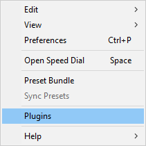

*OrcaSlicer 2.5.2 · The main menu. Plugins opens the Plugins dialog.*

2. **Find Line Art Studio on Orca Cloud and subscribe.** In the Plugins dialog, press Install plugin. It opens Orca Cloud in your browser: sign in, find Line Art Studio and press Subscribe there. Back in the Plugins dialog, press Refresh. Line Art Studio appears in the list with Subscribed in the Source column, and OrcaSlicer downloads and installs it.

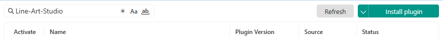

*OrcaSlicer 2.5.2 · The top of the Plugins dialog. Install plugin opens Orca Cloud, where the Subscribe button is; Refresh then brings the plugin into this list. The search box filters the list.*

3. **Activate it.** In the Plugins dialog, make sure Line Art Studio is Activated. Tick its box in the Activate column. An installed plugin that is inactive adds no tab and no slicing step. The arrow before the name shows its two parts, the Line Art Studio tab (Pages) and the Line Art Studio G-code slicing step (Slicing Pipeline); keep both ticked.

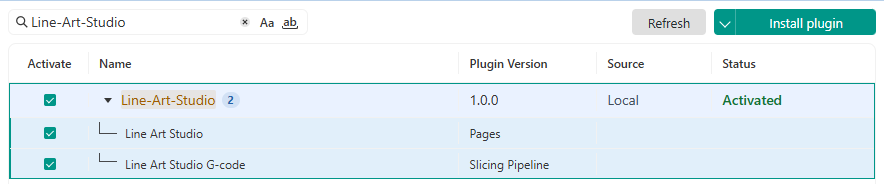

*OrcaSlicer 2.5.2 · Line Art Studio activated, with both of its parts ticked. This copy was installed from a local file for the capture, so its source reads Local; a subscribed copy reads Subscribed.*

4. **Allow the background thread, once.** The first time the plugin loads, OrcaSlicer asks whether it may create a thread. Choose Yes. The plugin computes the line in the background, so the tab stays responsive while it works. OrcaSlicer remembers the answer; you can change it later in the Plugins dialog, on the Permissions tab.

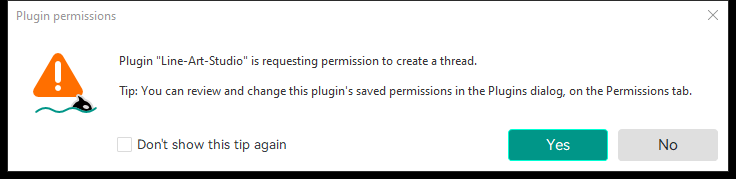

*OrcaSlicer 2.5.2 · The one-time permission prompt. Choose Yes.*

## 2. Where the tab is

Once activated, Line Art Studio adds its own tab to the row of tabs at the top of the OrcaSlicer window, after Prepare, Preview, Device, Project and Calibration. If the window is narrow and you have several plugin tabs, some of them move behind a menu button at the end of the row.

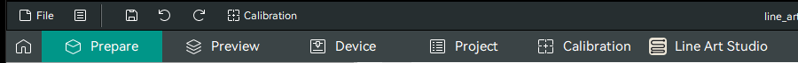

*OrcaSlicer 2.5.2 · The Line Art Studio tab in OrcaSlicer's tab row.*

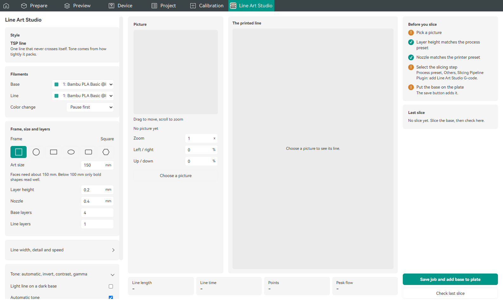

*OrcaSlicer 2.5.2 · The Line Art Studio tab open in OrcaSlicer, before a picture is chosen.*

## 3. Your first line art, step by step

This walk-through makes a 150 mm square portrait in two filaments: a white base and a black line, on a Bambu Lab X1 Carbon with a 0.4 mm nozzle.

1. **Choose a picture.** Open the Line Art Studio tab and press Choose a picture. In the Picture card, drag the picture to move it and scroll to zoom, or type values in Zoom, Left / right and Up / down. After a few seconds, or up to a minute for a detailed picture, The printed line shows the line that will be printed, with its length, print time, number of points and peak flow underneath.

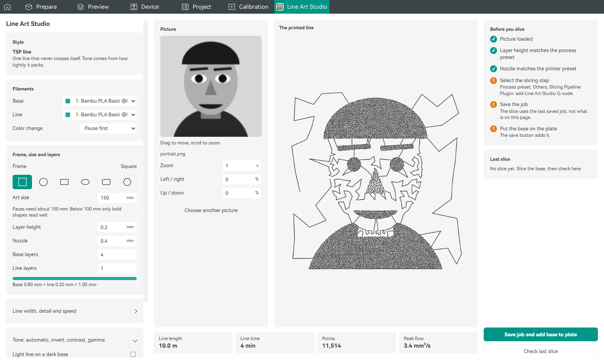

*OrcaSlicer 2.5.2 · The tab with the guide's drawn test portrait: the picture, the printed line next to it, and the Before you slice list on the right.*

2. **Pick the frame and size.** In Frame, size and layers, choose a frame: square, circle, rectangle, oval, rounded rectangle or hexagon. The picture is cropped to that shape and the line stays inside it. Square, circle and hexagon take one Art size; rectangle, oval and rounded rectangle take a Width and a Height. Each side must be at least 60 mm; faces need about 150 mm.

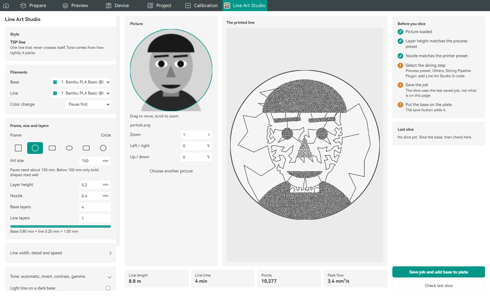

*OrcaSlicer 2.5.2 · The circle frame chosen.*

3. **Choose the filaments.** In Filaments, set Base to your light filament and Line to your dark one. The lists show the filaments of the current project, so add the second filament in OrcaSlicer's filament list first if it is missing. Check that Layer height and Nozzle match your process and printer presets.
4. **Save the job and add the base to the plate.** Press Save job and add base to plate. The tab saves the job and puts a base of the chosen shape on the plate, with each part already assigned to its filament. The first time, OrcaSlicer asks whether the plugin may read your picture file, then whether it may use the Python `open` event; choose Yes to both. OrcaSlicer then switches to the Prepare tab to show the base. Back in the Line Art Studio tab, the message above the button reads Saved. The base is being added to the plate; slice it when it appears. and the save and plate items in Before you slice are green.

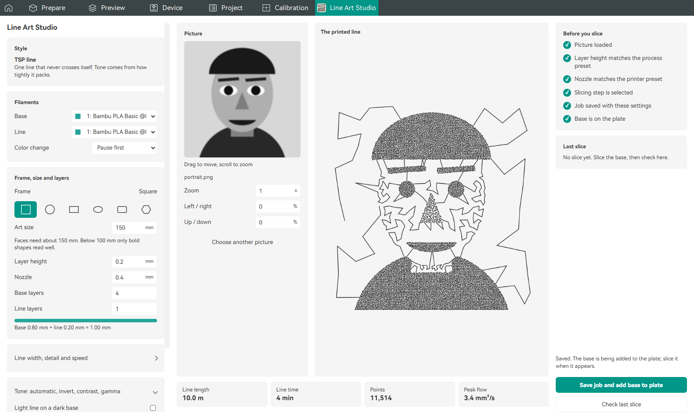

*OrcaSlicer 2.5.2 · The tab after saving, with the slicing step from step 5 already selected: every check in Before you slice has passed.*

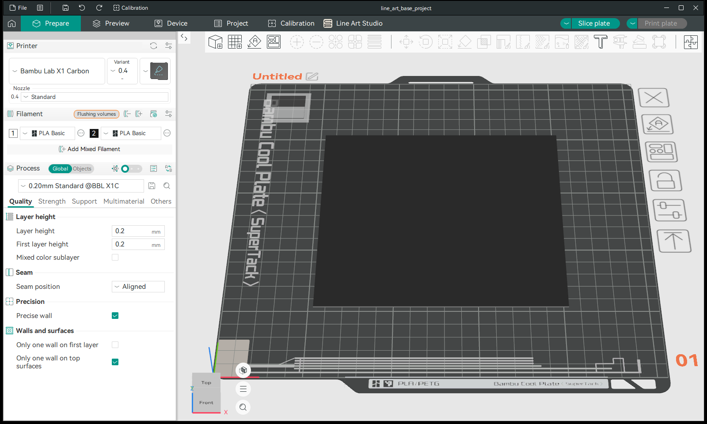

*OrcaSlicer 2.5.2 · The Prepare tab with the 150 mm square base on the plate. The top of the base is the line's layer, in filament 2.*

5. **Select the slicing step (once).** The picture is drawn when you slice. In the Prepare tab's process settings, open Others, find Slicing Pipeline Plugin, press Add plugin and choose Line Art Studio G-code. Save the process preset to keep it. Prints that are not the Line Art Studio base are left as they are, so the setting can stay on.

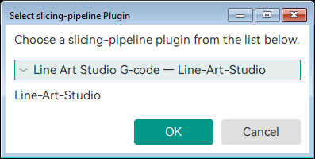

*OrcaSlicer 2.5.2 · Add plugin opens this list. Choose Line Art Studio G-code and press OK.*

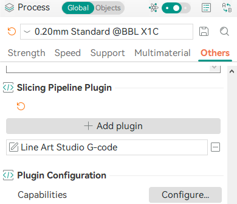

*OrcaSlicer 2.5.2 · The process preset's Others page with the slicing step added. The orange arrow marks the unsaved change; save the preset with the disk icon next to its name.*

6. **Slice.** Press Slice plate. The slicing step finds the top layers of the base and replaces them with the line. Back in the Line Art Studio tab, press Check last slice: the Last slice card reports what the step did, for example Replaced the top 1 layer(s) with a 10.0 m line from Z1, 4 min.
7. **Check the preview, then print.** On a Bambu Lab printer the Preview tab shows the line on the top layer. Then print as usual with Print plate.

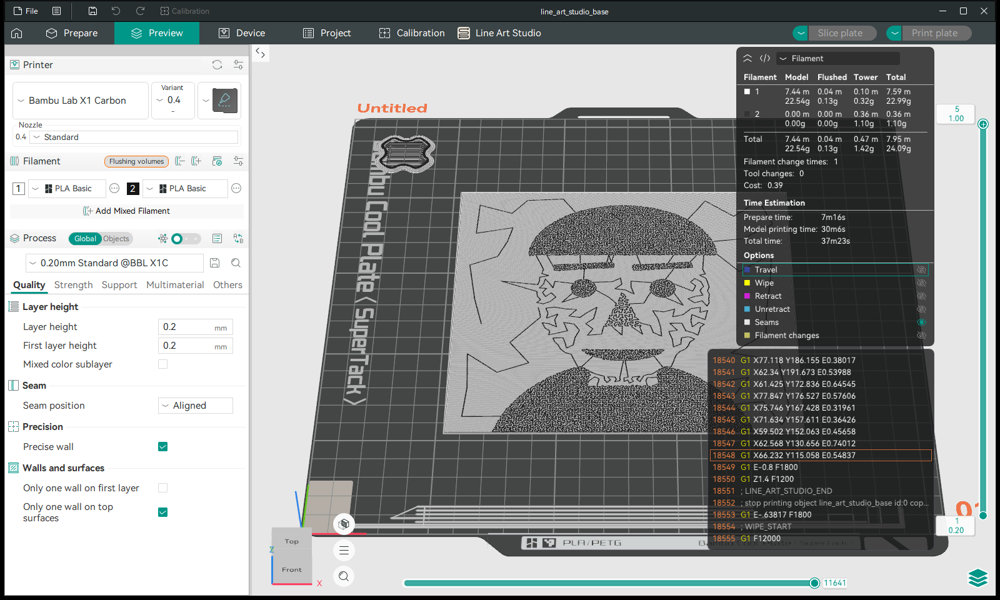

*OrcaSlicer 2.5.2 · The Preview tab with this job's finished G-code: the line on the top layer, ending at the plugin's `LINE_ART_STUDIO_END` marker.*

## 4. The key settings

Version 1.0.0 has one style, TSP line: one line that never crosses itself, whose tone comes from how tightly it packs. Changing a setting that affects the line recomputes it after a short pause.

| Setting | What it does | Default and range |
|---|---|---|
| Art size (Width, Height) | The size of the art on the plate. Faces need about 150 mm; below 100 mm only bold shapes read well. | 150 mm; at least 60 mm per side |
| Frame | Square, circle, rectangle, oval, rounded rectangle or hexagon. The picture, the line and the base all follow it. | Square |
| Layer height, Nozzle | Must match the process and printer presets, or the slice stops with a message. The Before you slice list checks this for you. | Taken from your presets |
| Base layers | How thick the base is, in layers. The bar under the fields shows base, line and total height. | 4 |
| Line layers | How many layers the line is stacked. More layers give a raised line. | 1; 1 to 10 |
| Line width | The width of the printed line. Changing the nozzle sets it to 1.05 times the nozzle. | 0.42 mm on a 0.4 mm nozzle; 0.5 to 1.5 times the nozzle |
| Detail spacing | How close two points of the line may be, as a multiple of the line width. Lower values give more detail and a longer line. | 1.3; 1.3 to 4.0 |
| Print speed | The speed of the line. If your filament's volumetric limit is lower, the tab says *The filament's flow limit holds the speed at ... mm/s.* | 40 mm/s |
| Automatic tone | Stretches the picture across its light-to-dark range and sharpens it. Leave it on for most photos. | On |
| Contrast | Spreads the tones apart around mid-gray. Raise it for a flat or pale picture. | 1.25; 0.1 to 4.0 |
| Gamma | Above 1 darkens the middle tones (more line); below 1 lightens them. | 1.0; 0.1 to 4.0 |
| Light line on a dark base | For a light line filament on a dark base: the picture is drawn as a negative so it still reads the right way round. | Off |
| Filaments: Base, Line | Which project filament prints the base and which prints the line. Different filaments give a filament change at the first line layer. | Filament 1 for both |
| Color change | Shown only when Base and Line are the same filament. Pause first pauses the print before the line so you can swap the filament by hand; None prints straight on. | Pause first |

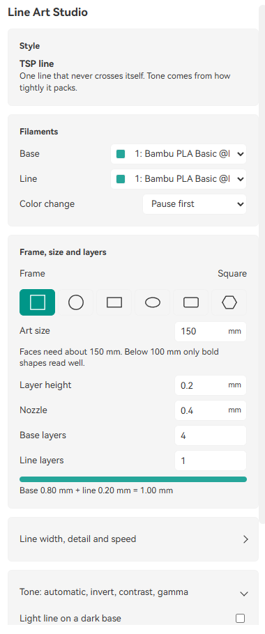

*OrcaSlicer 2.5.2 · Filaments, frame, size, layers and the start of the tone card.*

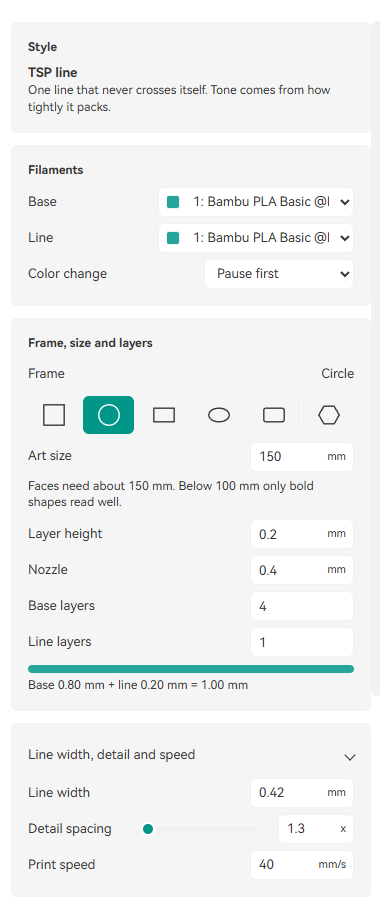

*OrcaSlicer 2.5.2 · The folded Line width, detail and speed card, opened.*

## 5. Printing tips for an X1 Carbon with AMS

These tips assume a Bambu Lab X1 Carbon with AMS, a Cool Plate SuperTack and the prime tower on.

- **Use two filaments.** Load the base filament (for example white PLA) and the line filament (for example black PLA) in the AMS, add both to the project, and choose them as Base and Line. The AMS changes filament once, at the first line layer.
- **Pick a strong color contrast.** The densest areas are only about half covered by the line, so dark areas read as dense texture, not solid black. White and black work best; similar colors wash the picture out.
- **Go big for faces.** About 150 mm reads well for a face. Below 100 mm only bold shapes come through.
- **Keep the prime tower on.** It primes the line filament after the change, so the line starts cleanly. Leave room for it; the base must stay inside the printable area.
- **Use the Cool Plate SuperTack plate type** in OrcaSlicer when that is the plate on the printer, so the bed temperature matches.
- **Trust the preview.** On a Bambu Lab printer the Preview tab shows the finished line, as in the picture above. If it shows a plain top layer, see [Troubleshooting](#6-troubleshooting).

## 6. Troubleshooting

Slice results appear in the tab's Last slice card (press Check last slice). The messages below are the plugin's own wording.

**The slice says it is not the Line Art Studio base**

Not the Line Art Studio base: top layer is ... x ... mm, expected ... x ... mm. G-code left as it is. or Not the Line Art Studio base: the top layer does not have the shape of the expected ... mm base. G-code left as it is. The base on the plate no longer matches the saved job: the size or frame changed after the base was added, or the base was rotated or scaled on the plate. Delete the base from the plate and press Save job and add base to plate again. When the tab itself notices this it says Saved, but the base on the plate has the old size or shape. Delete it from the plate and press the button again.

**Layer height or nozzle mismatch**

Line Art Studio: The job uses a 0.2 mm layer height but this slice uses 0.16 mm. Change the process preset's layer height, or the job's, and slice again. Line Art Studio: The job is for a 0.4 mm nozzle but the printer preset uses 0.6 mm. Make the tab's Layer height and Nozzle match your presets, save the job again and slice.

**The wrong filament is on the line layer**

Line Art Studio: The art layers use filament 1, but the job asks for filament 2. Delete the base from the plate, press the save button again, and slice. The base's parts were reassigned on the plate, or the filament list changed. Follow the message. If the tab says This project has 1 filament(s). Add more in the filament list first., add the second filament to the project.

**The line is not in the preview**

Check these in order: the slicing step Line Art Studio G-code is selected in the process preset (the tab's list shows Select the slicing step if not); the job was saved after your last change (Save the job in the list; the slice uses the last saved job, not what is on the page); and the Last slice card does not say No saved job; G-code left as it is. On printers other than Bambu Lab, the slicer preview shows the plain base; the line is still in the exported file.

**The picture is too light**

The picture is too light to draw. Raise the contrast, or turn Invert off. Turn on Automatic tone, raise Contrast, or set Gamma above 1. If Light line on a dark base is on but your line filament is the dark one, turn it off; the list shows Turn off Light line on a dark base in that case.

**You answered No to the thread permission**

The plugin still works: it computes the line without a background thread instead. It is slower in use, because OrcaSlicer waits while each line is computed. To allow it later, open the Plugins dialog, select Line Art Studio and turn on Threading on the Permissions tab.

Line Art Studio 1.0.0 for OrcaSlicer 2.5. Free and open source, GPL-3.0-or-later. Source: [github.com/barismert98/orcaslicer-line-art-studio](https://github.com/barismert98/orcaslicer-line-art-studio).
